<p align="center"></p>

# Car Rental Reservation and Vehicle Return Management System

**Project 19 · DBMS Project-Based Learning (PBL)**
Bangla Deekshan Raj · Woxsen University · Student ID 25WU0102057 · 2026

A relational database system in MySQL 8, normalized to 3NF, for managing vehicles, customers, reservations, vehicle pickup and return, damage, invoices and payments across a multi-branch car rental agency. Business rules are enforced inside the database (3 triggers, 14 CHECK constraints), and two front ends sit on top of it: a Tkinter desktop app and the **Woxsen Car Rentals** web app.

> ### ▶ [Try it now: live demo (no install)](https://rajdeekshan-cmd.github.io/DBMS_PBL/)
> Opens in any browser and runs on a built-in snapshot of the sample data, so no database is needed. It is read-only: browsing, filters, date-based availability and the reports work, while booking and editing show a "demo mode" message. The full MySQL-backed version is under [Run the prototype](#run-the-prototype) below.

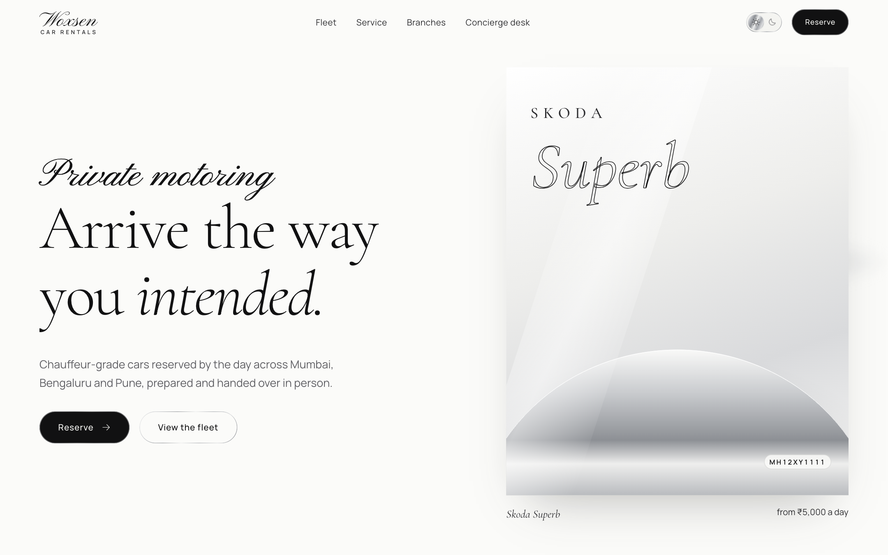

| | |
|---|---|
| **Live demo** | [rajdeekshan-cmd.github.io/DBMS_PBL](https://rajdeekshan-cmd.github.io/DBMS_PBL/) (sample data runs in the browser) |
| **Final report** | [`report/Project19_Report.pdf`](./report/Project19_Report.pdf) |

## Submission contents

| Item | Location |
|---|---|
| Review 1 deck | [`review-1/Review-1-Presentation.pptx`](./review-1/Review-1-Presentation.pptx) |
| Review 2 deck | [`review-2/Review-2-Presentation.pptx`](./review-2/Review-2-Presentation.pptx) |
| Review 3 (final) deck | [`review-3/Review-3-Presentation.pptx`](./review-3/Review-3-Presentation.pptx) |
| Final report (PDF) | [`report/Project19_Report.pdf`](./report/Project19_Report.pdf) |
| SQL: schema, triggers, sample data, queries, views | [`review-2/sql/`](./review-2/sql) |
| ER diagram | below, and [`docs/er_diagram.png`](./docs/er_diagram.png) |
| Architecture diagram | [`docs/architecture.png`](./docs/architecture.png) |
| Desktop application (Tkinter) | [`review-3/desktop_app/`](./review-3/desktop_app) |
| Web application (Flask API + React) | [`review-3/web/`](./review-3/web) |

## ER diagram

Rendered from the implemented schema (`review-2/sql/01_schema.sql`). 12 tables, 13 foreign keys.

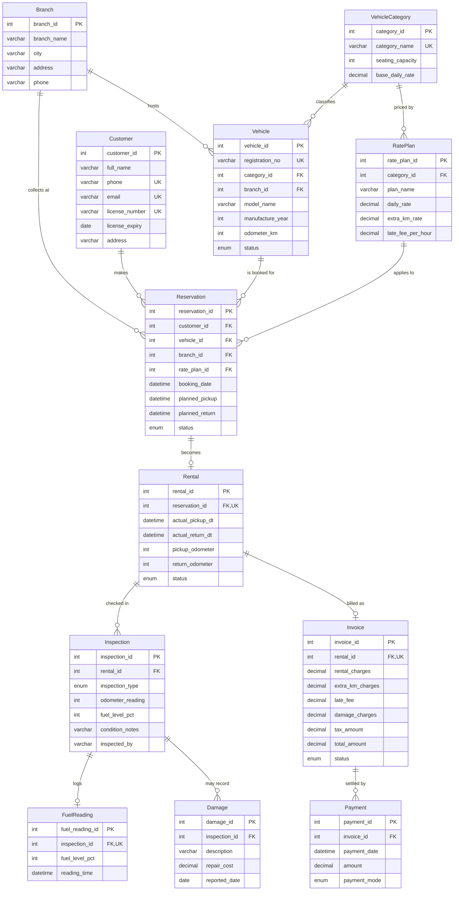

## Screenshots

All captured from the running web app on the sample database (`review-3/screenshots/`).

**Landing page**


**The fleet, a pinned horizontal gallery driven by scroll**


**Fleet and availability: only cars free for the whole period**

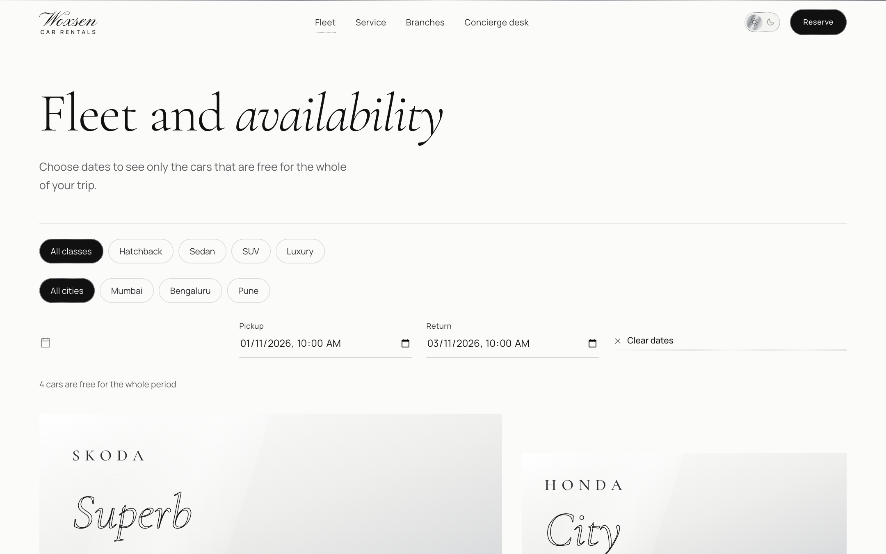

**Booking, step 1: choose a car**

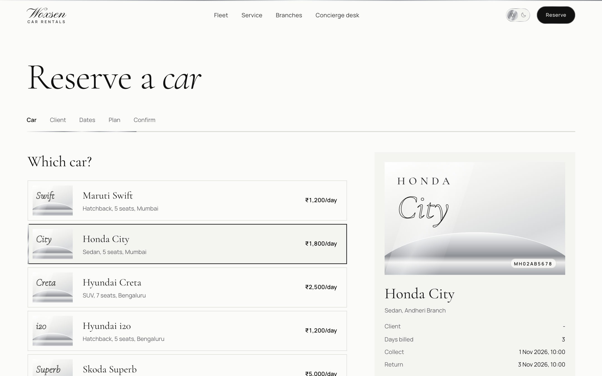

**Booking, step 2: choose a client (an expired licence is flagged)**

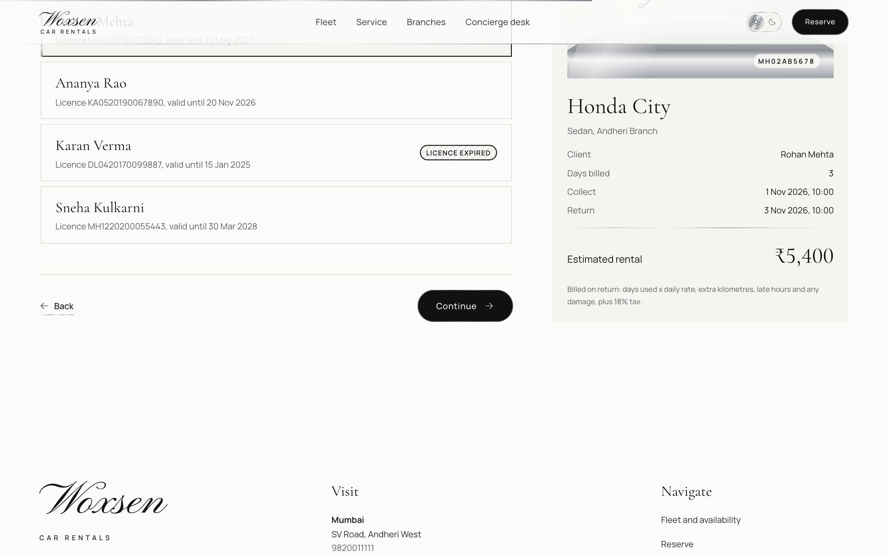

**Booking, step 3: dates, with a live availability check**

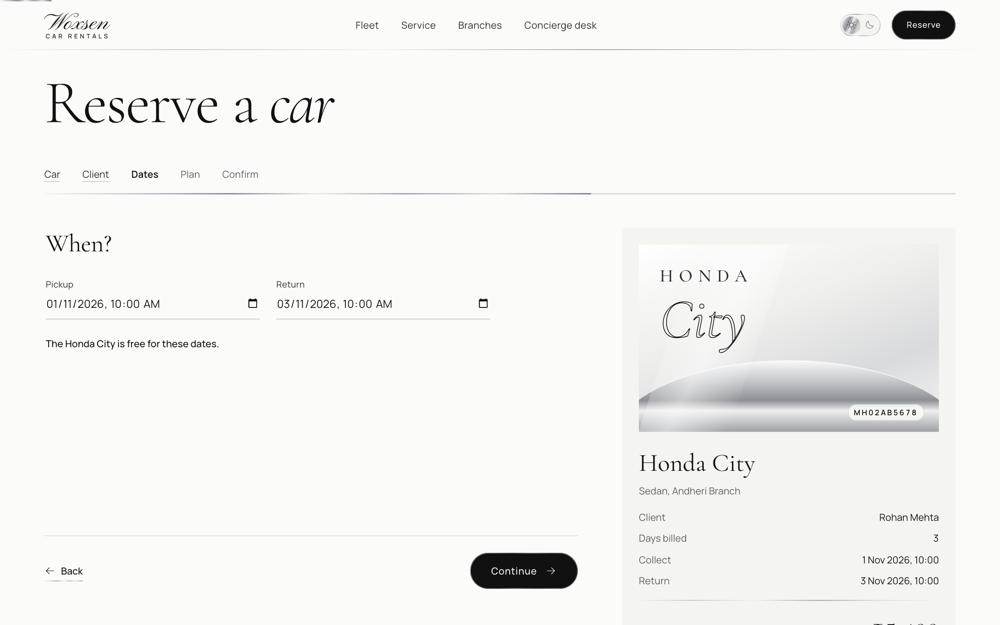

**Booking, step 5: review and confirm**

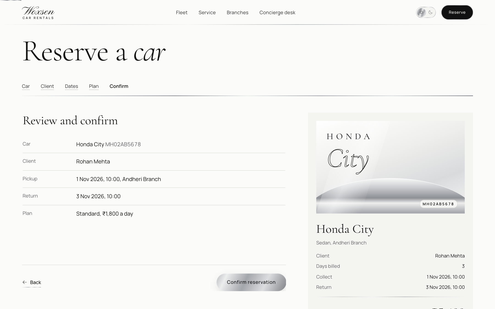

**Concierge desk: reservations**

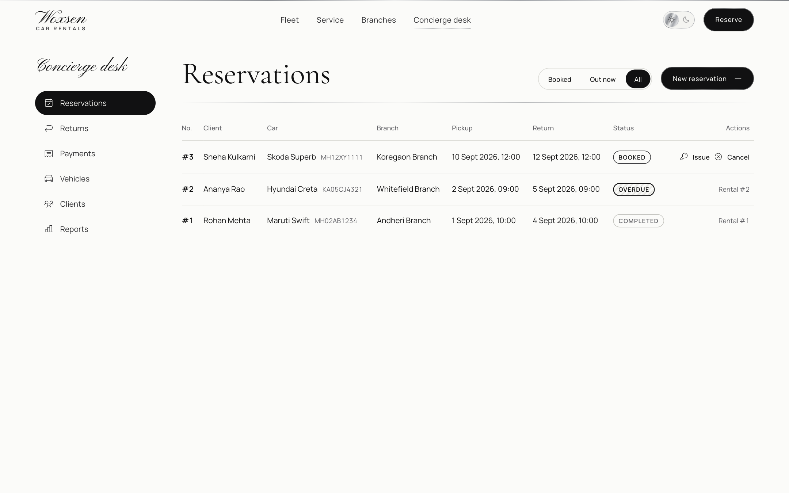

**Issue a vehicle: pickup odometer, fuel level and inspection**

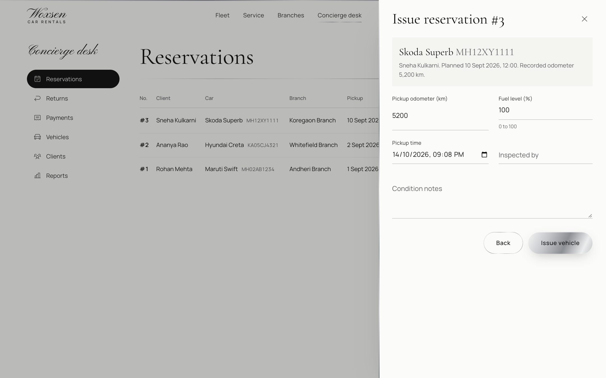

**Return a vehicle: inspection, damage, and billing**

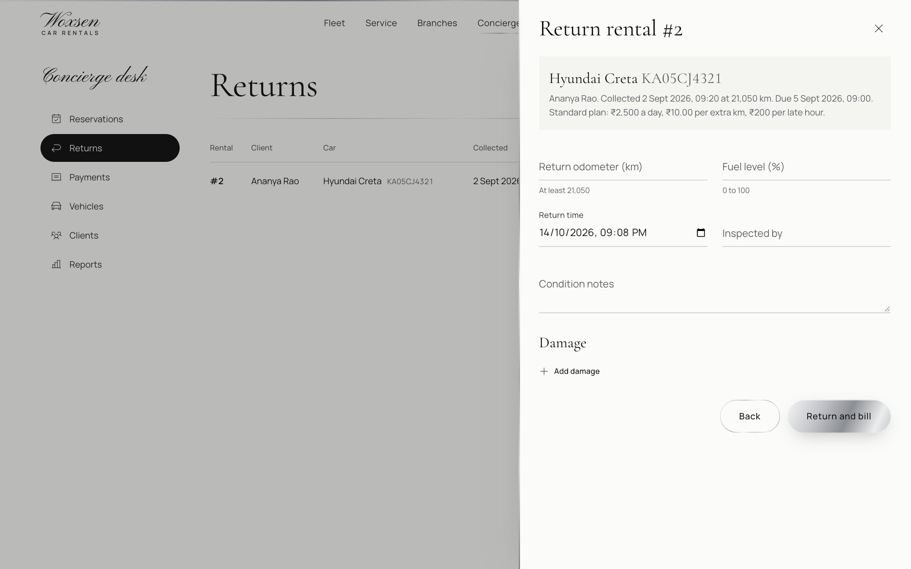

**Payments and invoices**

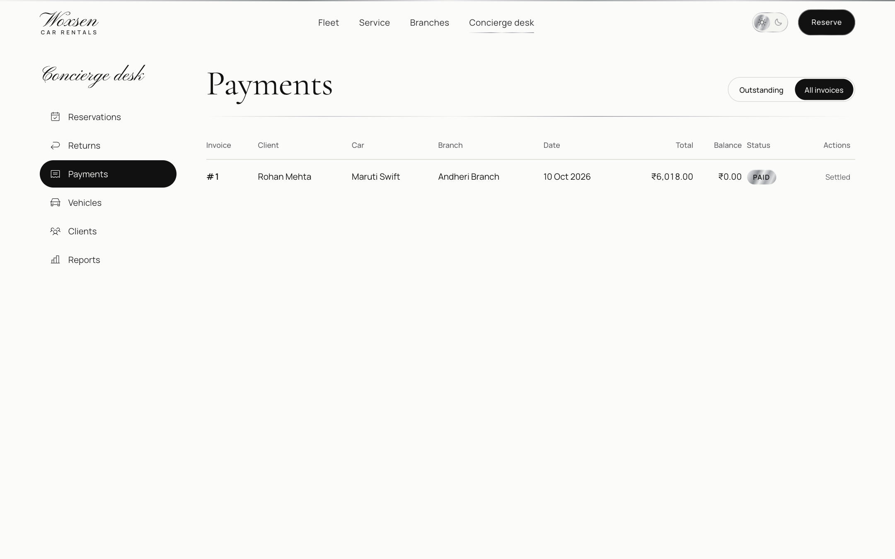

**Vehicles**

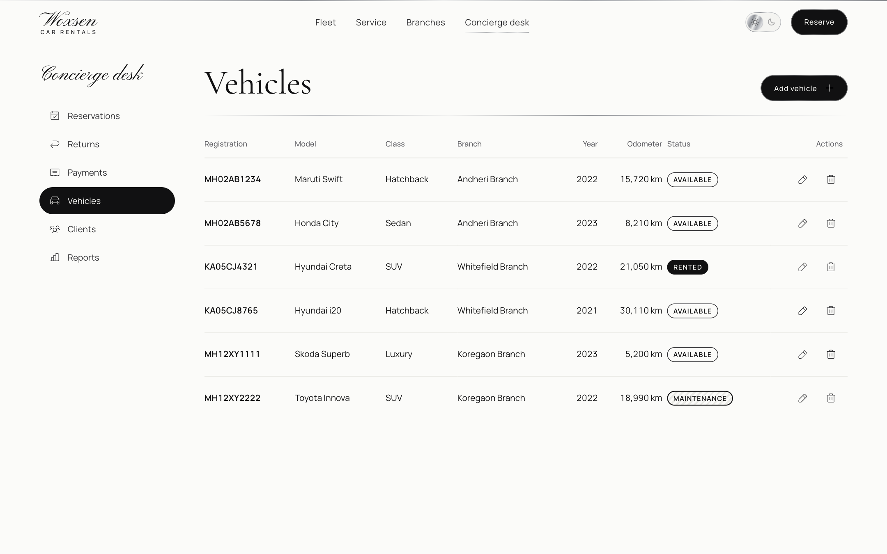

**Clients**

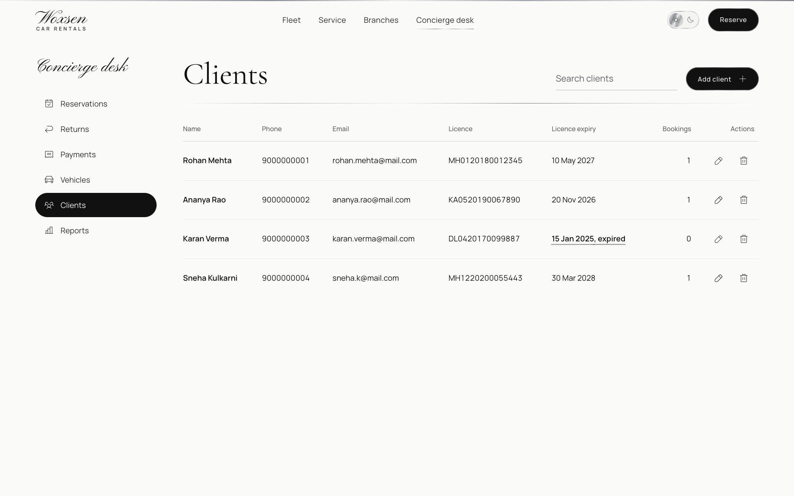

**Report: branch revenue**

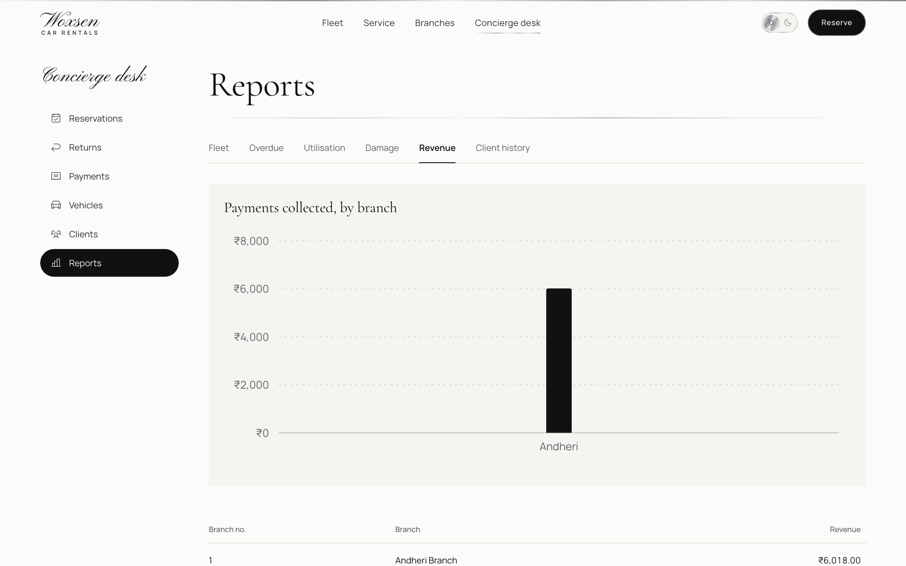

**Report: vehicle utilisation**

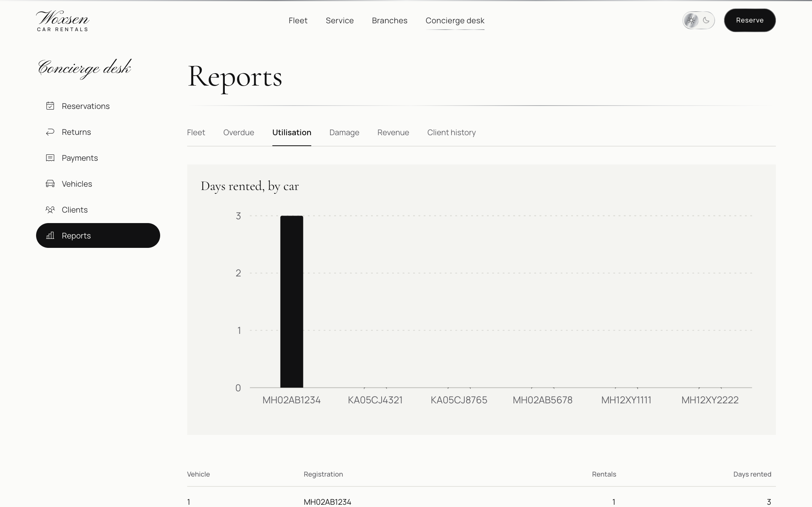

**Dark theme**


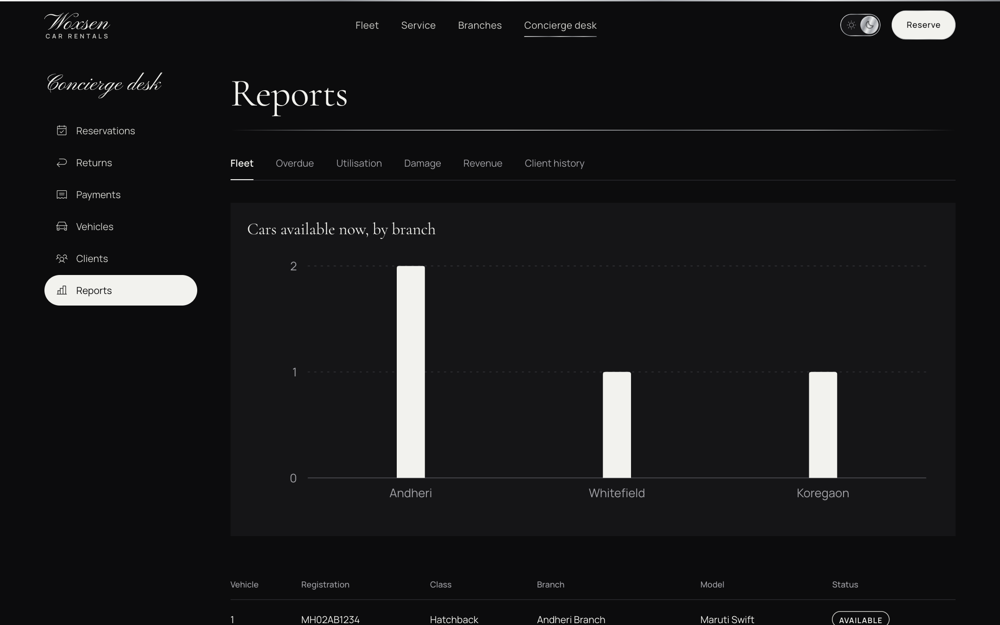

**Mobile**

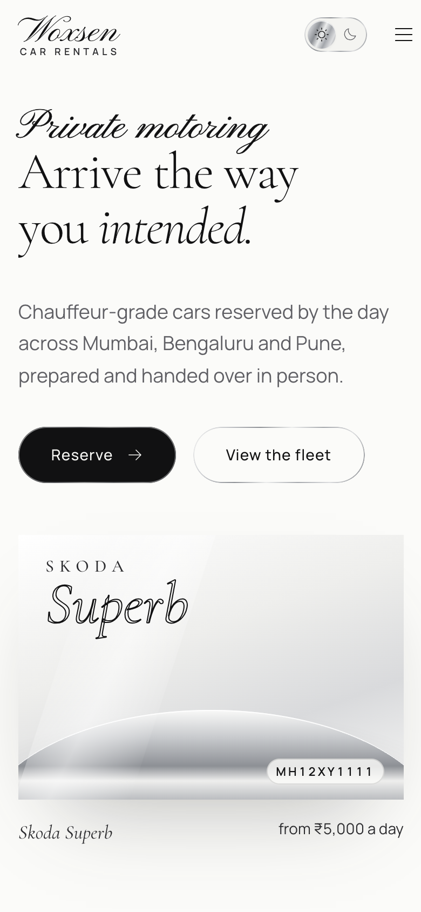

## Repository layout

```
review-1/   problem statement, ER diagram (deck)
review-2/   normalization, DDL, triggers, sample data, queries (deck + sql/)
review-3/   final deck and the working prototype
  desktop_app/   Python + Tkinter application
  web/
    backend/     Flask REST API
    frontend/    React + Vite website (Woxsen Car Rentals)
  screenshots/   captured from the running web app
report/     final report (PDF)
docs/       ER diagram, architecture diagram, logo
```

## Design highlights

- **3NF** with 12 tables, 13 foreign keys, 7 indexes and unique keys on registration, phone, email and licence numbers.
- **3 triggers in the database:** no overlapping reservations for a vehicle, driving licence must be valid at pickup, and the vehicle status and odometer update automatically on pickup and return.
- **14 CHECK constraints** on rates, capacity, odometer, dates, fuel level, repair cost and amounts.
- **6 reporting views:** fleet availability, overdue rentals, vehicle utilization, damage report, branch revenue, customer history.
- **Atomic operations:** issuing a vehicle, returning it with its invoice, and recording a payment each run as one transaction. If any step fails, everything rolls back. All SQL is parameterized.
- **Date-aware availability:** a car is offered only if it is not in maintenance or retired, has no booked or issued reservation overlapping the dates, and is not still out on an overdue rental.

### Invoice calculation

| Line | Rule |
|---|---|
| Days used | `max(1, whole days between pickup and return + 1)` |
| Rental | daily rate x days used |
| Extra kilometres | kilometres above 200 per day x extra-km rate |
| Late fee | whole hours after the planned return x hourly fee |
| Damage | sum of recorded repair costs |
| Tax | 18% of the subtotal |

## Run the prototype

Requirements: MySQL 8, Python 3.9+, and Node 18+ (only for the web front end).

```bash
# 1. Create the database (from the repo root). 01_schema.sql drops and recreates car_rental_db.
mysql -u root -p < review-2/sql/01_schema.sql
mysql -u root -p < review-2/sql/02_sample_data.sql
mysql -u root -p < review-2/sql/03_queries_and_views.sql

# 2a. Desktop app: set your MySQL password in review-3/desktop_app/db.py, then
pip install -r review-3/desktop_app/requirements.txt
python review-3/desktop_app/app.py

# 2b. Web app, API (copy .env.example to .env and set DB_PASSWORD first)
cd review-3/web/backend
python3 -m venv venv && ./venv/bin/pip install -r requirements.txt
./venv/bin/python app.py                  # http://localhost:5050/api

# 2c. Web app, website (in a second terminal)
cd review-3/web/frontend
npm install
npm run dev                               # http://localhost:5173  (admin: /admin)
```

The web app also adds what the desktop app lacked: payments (partial or full), reservation cancellation, damage saved with the return inspection, and clean error messages for every database rule.

The live demo is published from this repository by GitHub Actions (`.github/workflows/pages.yml`) on every push to `main`.
